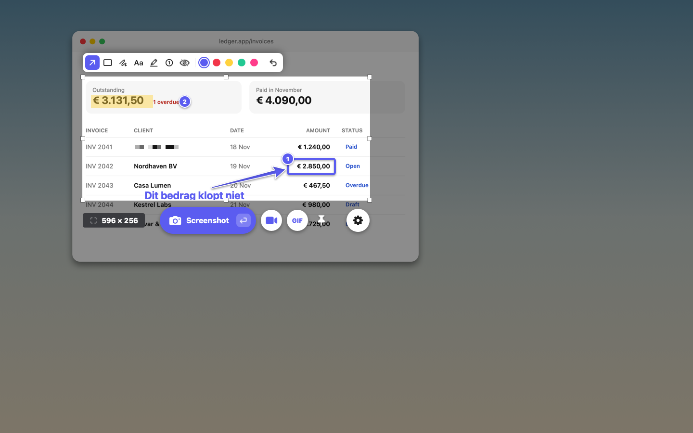
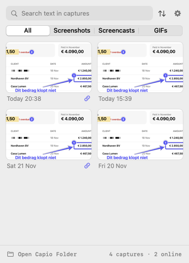

# Capio

A menu bar app for the Mac: capture an area of your screen, draw on it, and get a link from your own
[Amfora](https://github.com/Solutionmax/amfora). Screenshots, screencasts and GIFs stay on your Mac until you
ask for a link.

## What it does

- **Screenshot.** Drag an area or click a window, draw on it (arrow, rectangle, pen, text, highlight, numbers,
  blur), press Return. The picture lands in `~/Capio` and on the clipboard.
- **Screencast and GIF.** Record an area, with the microphone and a webcam bubble if you like, pause and resume.
- **A link when you want one.** Right click a capture in the history and choose Create External Link. The file goes to
  your Amfora and the link is on your clipboard. A link works for 7 days; after that Capio removes the share and the
  file from Amfora, the capture stays on your Mac.
- **History.** Click the menu bar icon: search (also the text inside screenshots), filter, pin a picture on screen.
- **Your own quality.** PNG or JPEG, Retina or Normal size; video at Original, 1080p or 720p and 30 or 60 frames a
  second; GIF width and frames a second. Settings says what each choice costs in megabytes.

| Shortcut | Action |
| --- | --- |
| ⌃⌘1 | Window screenshot: the window under the mouse |
| ⌃⌘2 | Select an area, draw, Return saves |
| ⌃⌘3 | Quick screenshot: drag and let go |
| ⌃⌘4 | Screencast |
| ⌃⌘5 | GIF |

All five can be changed in Settings, Shortcuts.

## Install

1. Download `Capio-<version>.zip` from [Releases](https://github.com/Solutionmax/capio/releases), unzip it and move
   Capio to Applications.
2. Capio is signed with its own certificate, not through Apple. The first time, macOS refuses to open it: open
   System Settings, Privacy & Security, scroll down and choose **Open Anyway**.
3. Allow **Screen Recording** when macOS asks (System Settings, Privacy & Security, Screen & System Audio
   Recording). The microphone and the camera are only asked for when you turn them on.

Needs macOS 15 or later, on Apple silicon or Intel.

## Connect it to Amfora

Capio works without Amfora: captures are saved and copied. For links you need an Amfora installation, version 2.4 or
later.

1. In Amfora open **Profile**, **API keys**, **New key** and choose **Full access**.
2. In Capio open Settings, Sharing. Fill in the address of your Amfora and the key, then **Save and test**.

The key is kept in your Keychain. Turn on "Always create an external link" if every capture should get a link at
once.

## Build

On a Mac with Xcode: `./build.sh` runs the self test, builds a universal app (Apple silicon and Intel), draws the
icon, signs it and zips it to `build/`. Without a signing identity it signs ad hoc, and macOS then asks for Screen
Recording again after every build; `Tools/make-signing-identity.sh` makes an own identity once, which `build.sh`
picks up by itself. `./snapshot.sh` draws every screen to `build/shots/` off screen, without any permission.

Live upload check against an Amfora, with a full access key on stdin:
`.build/release/capio-selftest --amfora https://files.example.net < key.txt`

## Layout

- `Sources/CapioCore`: geometry, annotations and their rendering, history index, Amfora client, quality choices,
  icon. No AppKit.
- `Sources/Capio`: the app (overlay, action bar, recorder, toast, history, settings, snapshot mode).
- `Sources/capio-selftest`: assert based checks (`swift run capio-selftest`).
