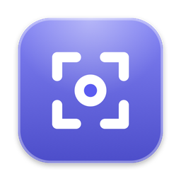
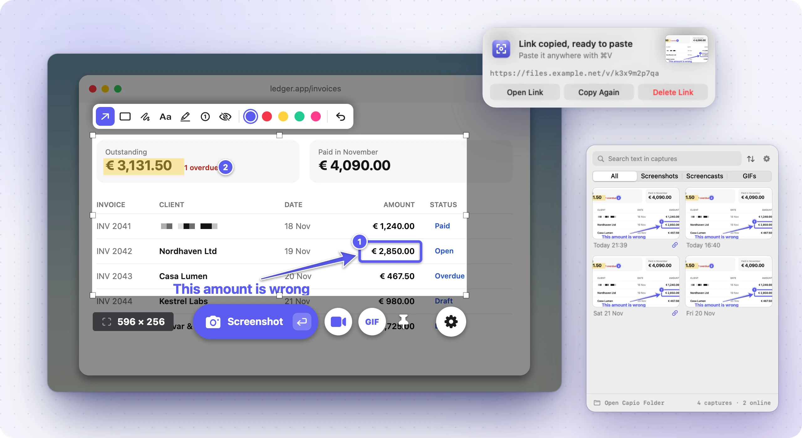
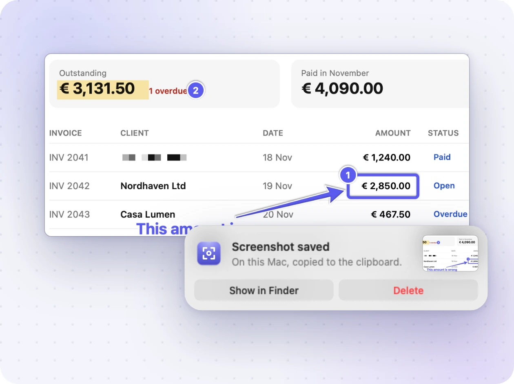
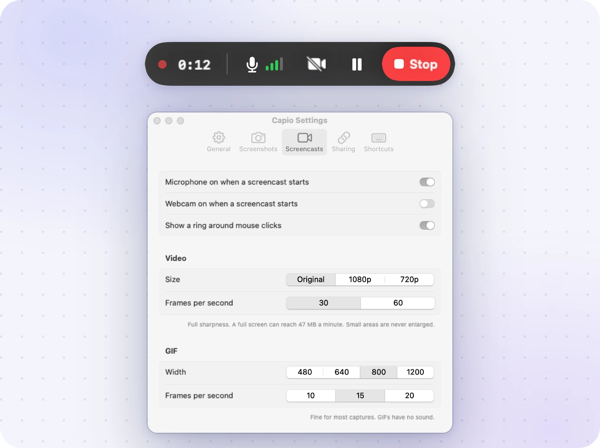

  

<h1 align="center">Capio</h1>

  <b>Capture your screen, draw on it, share it from your own server.</b> 
  A menu bar app for the Mac. Screenshots, screencasts and GIFs, with a link from your own
  <a href="https://github.com/Solutionmax/amfora">Amfora</a> when you want one.

  
  
  
  
  

  <a href="https://github.com/Solutionmax/capio/releases/latest">Download</a> ·
  <a href="#install">Install</a> ·
  <a href="#connect-it-to-amfora">Connect to Amfora</a> ·
  <a href="#shortcuts">Shortcuts</a> ·
  <a href="#build">Build</a>

  

## How it works

### 1. Capture

Press a shortcut and drag an area, or click a window. Take a screenshot, or record the area as a screencast or a
GIF, with the microphone and a webcam bubble if you like.

### 2. Draw

Point at things before you save: arrow, rectangle, pen, text, highlight, numbers and blur, in five colours. Return
saves. The picture lands in `~/Capio` and on your clipboard.

### 3. Share when you want to

Everything stays on your Mac. Right click a capture in the history and choose **Create External Link**: the file
goes to your own Amfora and the link is on your clipboard. A link works for 7 days. After that Capio removes the
share and the file from Amfora again; the capture stays on your Mac.

<table>
  <tr>
    <td width="50%"></td>
    <td width="50%"></td>
  </tr>
  <tr>
    <td valign="top"><b>Saved at once.</b> On your Mac and on the clipboard, with the text inside the picture made searchable.</td>
    <td valign="top"><b>Your own quality.</b> Video at Original, 1080p or 720p and 30 or 60 frames a second. Settings says what a choice costs in megabytes.</td>
  </tr>
</table>

## What is in the box

- **Screenshots** as PNG or JPEG, at Retina or Normal size.
- **Screencasts** as MP4, with microphone, webcam bubble, pause and a ring around mouse clicks.
- **GIFs** at the width and the frames a second you choose.
- **History** in the menu bar: search (also the text inside screenshots), filter, pin a picture on screen.
- **Links from your own server**, made only when you ask, gone again after 7 days.
- **No account and no cloud of ours.** Capio talks to your Mac and to the Amfora you name, nothing else.

## Shortcuts

| Shortcut | Action |
| --- | --- |
| ⌃⌘1 | Window screenshot: the window under the mouse |
| ⌃⌘2 | Select an area, draw, Return saves |
| ⌃⌘3 | Quick screenshot: drag and let go |
| ⌃⌘4 | Screencast |
| ⌃⌘5 | GIF |

All five can be changed in Settings, Shortcuts.

## Install

1. Download `Capio-<version>.zip` from [Releases](https://github.com/Solutionmax/capio/releases/latest), unzip it and
   move Capio to Applications.
2. Capio is signed with its own certificate, not through Apple. The first time, macOS refuses to open it: open
   System Settings, Privacy & Security, scroll down and choose **Open Anyway**.
3. Allow **Screen Recording** when macOS asks (System Settings, Privacy & Security, Screen & System Audio
   Recording). The microphone and the camera are only asked for when you turn them on.

Needs macOS 15 or later, on Apple silicon or Intel.

## Connect it to Amfora

Capio works without Amfora: captures are saved and copied. For links you need an
[Amfora](https://github.com/Solutionmax/amfora) installation, version 2.4 or later.

1. In Amfora open **Profile**, **API keys**, **New key** and choose **Full access**.
2. In Capio open Settings, Sharing. Fill in the address of your Amfora and the key, then **Save and test**.

The key is kept in your Keychain. Turn on "Always create an external link" if every capture should get a link at
once.

## Build

On a Mac with Xcode: `./build.sh` runs the self test, builds a universal app (Apple silicon and Intel), draws the
icon, signs it and zips it to `build/`. Without a signing identity it signs ad hoc, and macOS then asks for Screen
Recording again after every build; `Tools/make-signing-identity.sh` makes an own identity once, which `build.sh`
picks up by itself. `./snapshot.sh` draws every screen to `build/shots/` off screen, without any permission
(`CAPIO_SNAPSHOT_SCALE=2 ./snapshot.sh` for Retina size).

Live upload check against an Amfora, with a full access key on stdin:
`.build/release/capio-selftest --amfora https://files.example.net < key.txt`

## Layout

- `Sources/CapioCore`: geometry, annotations and their rendering, history index, Amfora client, quality choices,
  icon. No AppKit.
- `Sources/Capio`: the app (overlay, action bar, recorder, toast, history, settings, snapshot mode).
- `Sources/capio-selftest`: assert based checks (`swift run capio-selftest`).

  A <a href="https://solutionmax.net/">SolutionMAX</a> product

